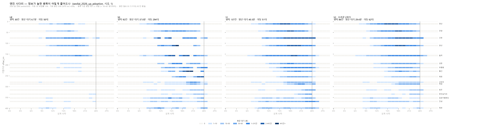
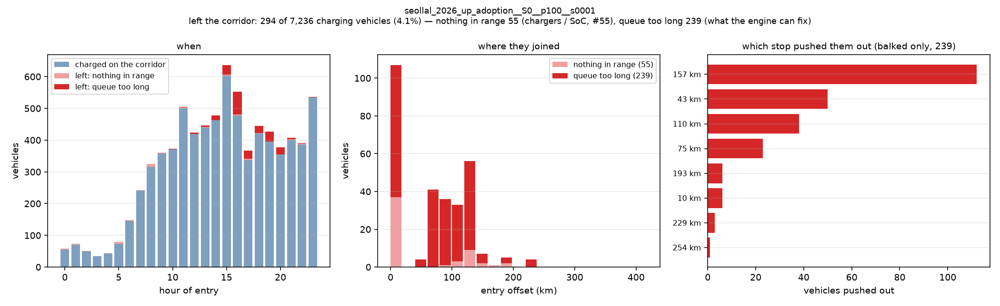
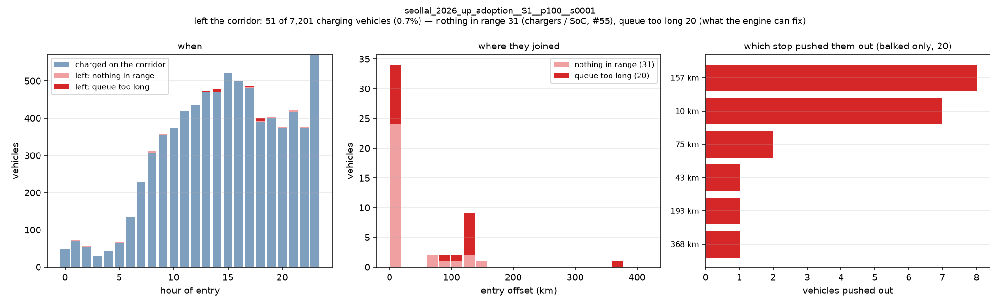

# 엔진 사다리 — 무엇이 좋아지고 무엇이 나빠지나 (#120 · #121)

> 한 줄: **사다리는 총 사회적 비용에서만 단조롭게 좋아진다.** S0 → S1 → S2 가
> **바닥–천장 격차 축소율** 0% → 4.5% → **21.0%** (시드 14개, 이탈 맞춤).
> 완전 예측 벤치마크는 27.5% — **예측 오차 손실 6.5 ± 3.7 %p** (#121).
>
> 그런데 **S1 은 병목 칸이 14개 시드 전부에서 S0 보다 많다** (93.5 → 133.1).
> 나빠진 게 아니라 **S0 가 내보낸 차 183대를 S1 이 붙잡고 있는 값**이다.



**이탈은 반드시 같이 본다** — 위 그림만 보면 S0 가 제일 좋아 보인다.

| S0 (이탈 294대) | S1 (이탈 51대) |
|---|---|
|  |  |

재현:

```bash
python scripts/plot_ladder.py --seed 1                 # ① 사다리 히트맵
python scripts/gap_table.py  --seeds 1-20              # ② 격차 축소율 표
python scripts/plot_escaped.py <run_id>                # 이탈 — ①과 반드시 같이 본다
```

> 그림은 **시드 1** 이다. 병목 칸·평균 대기는 14개 시드 평균과 비슷하지만,
> **총 사회적 비용은 시드 1 이 S1 에게 유난히 나쁘다** (§1). 숫자를 말할 때는
> 그림의 시드가 아니라 §2 의 표를 쓸 것.

---

## 1. ⚠ 시드 하나로 보면 틀린다

처음에 **시드 1 하나**로 보고 *"S1 이 S0 보다 나쁘다"* 고 판단했다. 14개 시드로
보니 **총 사회적 비용에서는 S1 이 낫다.** 기록으로 남긴다.

| | 시드 1 | **14개 시드 평균** |
|---|---|---|
| S0 vs S1 총비용 | S1 이 **나쁨** (7,313 vs 7,283) | S1 이 **나음** (7,291 vs 7,516) |
| 손익분기 이탈 비용 | 127분 (가정값 120 **바로 옆**) | **46분** (가정값 120 과 멀다) |

시드 1 은 **S1 에게 유난히 나쁜 시드**였다. 14개 중 **9개**에서 S1 이 S0 보다 낫다.

> **규칙: 사다리 비교는 시드 하나로 말하지 않는다.** 단계 간 차이가 시드 간 분산과
> 같은 크기다.

---

## 2. 바닥–천장 격차 축소율 (바닥 S0 = 0%, 천장 UE = 100%)

> **지표 이름:** **바닥–천장 격차 축소율** (표에서는 `격차 축소율`, 영문 `gap closed (%)`).
> **바닥에서 천장까지의 거리 중 몇 %를 좁혔나.**
>
>     격차 축소율 = (S0 − 이 칸) / (S0 − UE) × 100
>
> **상한도 하한도 없다.**
>
> - **음수는 실제로 나온다** — S1 의 평균 대기 격차 축소율이 **−2.7%** 다 (바닥보다 나쁘다).
> - **100% 초과도 수식상 막혀 있지 않다.** UE 는 Wardrop 균형(**이기적** 균형)이고
>   SO(사후 최적해)는 별개의 기준선이다 (`UE_equilibrium.md`). 다만 **우리는 UE 를
>   넘는 것을 목표로 삼지 않는다** — DESIGN §1 이 "넘어야 할 대상이 아니라 메울 대상"
>   으로 못 박았다. 지표가 그 경우에도 안 깨지게 두는 것뿐이다.
>
> 그래서 "달성률·도달률·진행률" 로 부르지 않는다 (0~100 으로 들린다).
> **"최적" 이 들어간 이름도 쓰지 않는다** — UE 는 최적이 아니라 이기적 균형이다.

> **정정됨 (#121 · #123, 2026-10-13).** 이 절의 이전 표에서 "S2" 라고 적힌 행은
> 사실 **오라클(`PERFECT_ROLLING`)** 이었고, 시드 집합도 바닥·천장(14개)과 달랐다
> (6개). 지금 표는 **공통 시드 14개**, **이탈을 맞춘** 값이다.

**공통 시드 14개**, 이탈은 S1 대비 **+8% · +11%** 로 맞췄다
(`scripts/gap_table.py` 가 벗어나면 격차 축소율을 안 찍는다 — `docs/compare_rule.md`).

### 평균 대기 (분)

| 칸 | 값 | ±95% | 격차 축소율 | 이탈 |
|---|---:|---:|---:|---:|
| UE (천장) | 6.3 | 0.7 | 100% | 42.3 |
| S0 (바닥) | 38.5 | 2.0 | 0% | 238.9 |
| S1 | 39.3 | 1.9 | **−2.7%** | 55.5 |
| **S2 (관측 예측)** | 33.1 | 2.2 | **16.7%** | 60.1 |
| S3 | — | — | — | — |
| S4 | — | — | — | — |
| *완전예측 (벤치마크)* | *30.7* | *1.2* | *24.1%* | *61.4* |

### 총 사회적 비용 (h) = 총 체류 + 이탈 × 120분

| 칸 | 값 | ±95% | 격차 축소율 | 이탈 |
|---|---:|---:|---:|---:|
| UE (천장) | 2,557.6 | 98.3 | 100% | 42.3 |
| S0 (바닥) | 7,516.1 | 285.7 | 0% | 238.9 |
| S1 | 7,290.8 | 281.7 | **+4.5%** | 55.5 |
| **S2 (관측 예측)** | 6,474.2 | 313.6 | **+21.0%** | 60.1 |
| S3 | — | — | — | — |
| S4 | — | — | — | — |
| *완전예측 (벤치마크)* | *6,151.8* | *183.5* | *27.5%* | *61.4* |

**S3·S4 행의 빈칸이 남은 작업 목록이다.**

> *완전예측* 은 사다리 칸이 아니라 **벤치마크**다 — 시뮬레이터의 실제 미래를 넣으므로
> 현실에서 구현할 수 없다 (DESIGN §8.2).

### 격차 분해 (DESIGN §8.2) — 이 칸이 채워졌다

| | |
|---|---:|
| 관측 예측의 격차 축소율 | **21.0%** |
| 완전 예측의 격차 축소율 | **27.5%** |
| **예측 오차 손실** | **6.5 ± 3.7 %p** |
| **남은 몫** | **72.5%p** — 정보로는 못 메운다. S3·S4 의 과녁 |

**대응 비교로 냈다** (같은 시드끼리, n=14). 수준의 신뢰구간은 서로 겹치므로
(S2 ±314h · 벤치 ±184h) 그걸로 "차이가 없다" 고 읽으면 틀린다 — 두 칸은 같은
시드를 돌았고, 시드 간 변동이 양쪽에서 상쇄된다.

> **시드 6개로는 말할 수 없었다** (+4.5 ± 4.9 %p, 잡음과 구분 안 됨). 14개로
> 늘려서야 구분됐다. `gap_table.py` 가 구분이 안 되면 **"하나의 숫자로 말하지 말 것"**
> 을 찍는다.

---

## 3. S1 은 "빠르게" 가 아니라 "붙잡아서" 이긴다

지표마다 방향이 다르다. 14개 시드 평균:

| 지표 | S0 | S1 | |
|---|---:|---:|---|
| 이탈 | 238.9대 | **55.5대** | S1 압승 (**−77%**) |
| 병목 슬롯 | 93.5 | **133.1** | S1 패 — **14개 시드 전부에서** |
| 평균 대기 | 38.5분 | 39.3분 | S1 약간 패 |
| 총 사회적 비용 | 7,516h | **7,291h** | S1 승 (9/14 시드) |

**메커니즘은 하나다.** S0 는 못 기다리는 차 **239대를 고속도로 밖으로 내보낸다.**
나간 차는 충전기를 안 쓰므로 남은 사람의 줄이 짧아지고 히트맵이 밝아진다. S1 은
그 차들을 **붙잡는다.** 붙잡힌 차가 줄을 만들어 병목 칸이 늘고 평균 대기가
조금 오르지만, **2시간짜리 이탈을 면한다.**

이탈 이유를 가르면 더 분명하다 (시드 1):

| | S0 | S1 |
|---|---:|---:|
| 이탈 전체 | 294대 | 51대 |
| **balked** (줄이 길어서 — **엔진 책임**) | **239대** | **20대** |
| no_plan (닿는 곳이 없어서 — 충전기 공백) | 55대 | 31대 |

**엔진이 고칠 수 있는 이탈을 239 → 20 (−92%) 로 줄였다.** 이게 히트맵에는 전혀
안 보인다 — 오히려 S1 을 더 어둡게 만든다.

> **그래서 히트맵 혼자서는 거짓말을 한다.** 이탈 패널 없이 내놓으면 *"S0 가 제일
> 좋다"* 로 읽힌다.

---

## 4. 이탈 비용 가정이 순위를 바꾼다

총비용에 이탈을 세는데, **얼마로 세느냐**가 S0·S1 의 순위를 정한다.

    손익분기 이탈 비용 = 46.3분   (우리가 쓴 값 120분)

| 이탈 비용 | UE | S0 | S1 | S2 |
|---|---:|---:|---:|---:|
| 60분 | 2,515 | 7,277 | **7,235** | 5,897 |
| **120분 (가정)** | 2,558 | 7,516 | **7,291** | 5,947 |
| 180분 | 2,600 | 7,755 | **7,346** | 5,998 |

46분보다 크면 S1 이 이긴다. 우리 가정 120분은 **충분히 멀다** — 이 결론은 가정에
민감하지 않다. (시드 1 하나만 보면 손익분기가 127분이라 아슬아슬했다. §1 참고.)

---

## 5. ★ 숫자와 그림이 같은 것 — 병목 칸

    bottleneck_slots  =  히트맵에서 어두운 칸의 수
    (설계문서 §8.1: 휴게소 × 시간 평균 대기 ≥ 30분)

30분이 색 구간 경계(`WAIT_BINS_MIN`)와 **정확히 일치**한다 — "30–60 밴드부터" 가
곧 병목 슬롯이다. 심사에서 숫자를 의심받으면 **칸을 세라고 하면 된다.**

**기계가 그 약속을 검사한다.** `plot_ladder.py` 는 그리는 격자에서 다시 세어
`run_kpi` 와 대조하고, 다르면 **그림을 저장하지 않고 멈춘다.**

### 실제로 어긋났었다

처음에 가로축을 24시간으로 잘랐더니 **KPI 137 vs 그림 128** 이었다. 귀성 심야
도착이 자정을 넘어(최대 28시) 축에서 떨어진 것이다. `hours` 를 데이터 끝까지
늘려서 맞췄다 (익일 구간은 점선으로 가른다).

> 이걸 안 잡았으면, 발표에서 누군가 칸을 세는 순간 그림이 무너졌을 것이다.

---

## 6. UE 를 무엇으로 쓰는가 — **(A) 참고 천장으로 확정** (2026-10-11)

> **되돌릴 조건을 시험했고 충족되지 않았다 (2026-10-13, #64).** 실측 충전 로그
> 11,405건과 20개 UE 실행을 대조한 결과 휴게소×일 WAPE **78.49%**, 총 점유시간
> **−65.39%**, 충전 시작 피크 ±1시간 일치 **4/20** 이다.
> **UE = 참고 천장이 이제 추론이 아니라 실측 근거를 갖는다.**
>
> 그리고 UE 의 배분이 실측과 다른 **방향**도 드러났다 — UE 는 휴게소 안에서 가장
> 좋은 충전기 하나로 몰린다(`MAX_POWER_IDLE`). 혼합 운영사 휴게소 15곳 전부에서
> 한쪽이 세션을 거의 전부 가져가고, **분배 구간이 0곳**이다 (#128).
>
> ⇒ 우리가 100% 천장으로 쓰는 UE 는 **실측 대비 구조적으로 잘못 배분하는 해법**이다.
> 격차 축소율은 여전히 잘 정의되지만, 발표에서 이 말을 먼저 해야 한다.
> (`docs/sp3_64/review_20261013.md`)

UE 는 **하루 전체 계획을 열거하고 반복 균형을 돌린다.** 어떤 실시간 엔진보다
정보가 많다. 그래서 평균 대기 6.3분으로 S2 의 29.8분보다 **5배 좋다.**

두 입장이 양립하지 않는다.

**(A) 참고 천장으로 간다.** 근거는 DESIGN 자신의 조항이다.

설계문서 §1.2 는 UE 를 "재현 기준선" 으로 두면서 조건을 달았다 —
*"재현 검증(교통·충전) 없이 **'현실' 이라 부르지 않는다**"*. **그 조건이 아직
충족되지 않았다.**

| 재현 검증 | 상태 |
|---|---|
| 교통 (CTM) | 속도 MAPE 14.4% 통과 · **정체 재현율 0.00 미달** (#58) |
| 충전 (이용률) | **판정 보류** — 실측 로그 수집 중 (#112 · #64) |

그래서 문서를 뒤집은 것이 아니라 **문서 자신의 규칙을 적용했다.** 고친 곳:
DESIGN §1 관점(갱신 블록) · §1.2 용어표 · §1.3 RQ2 · §7.1 · §8.2 기준점 표.

**바닥은 S0 다** — 앱 화면만 보고 고르는 운전자가 지금 우리가 가진 가장 현실에
가까운 행동 모델이다. RQ2 도 "UE 대비" 에서 **"S0 대비(= S0→UE 격차의 몇 %)"** 로
바꿨다.

> **되돌릴 조건:** #64 의 실측 충전 로그가 들어와 재현 검증을 통과하면, UE 를 다시
> "재현된 현실" 로 부를 수 있는지 그때 판단한다.

---

## 7. "쏠림" 은 그대로 쓴다 — **자(尺)만 바꾼다**

처음에 *"쏠림 대신 병목이라고 하자"* 고 적었다. **그 권고를 거둔다.** 설계문서
§1.2 가 이유를 적어 뒀다 — *"'병목' 은 공급 부족으로 들림. 우리 주장은 **분배
문제**"*. 헤드라인 명사를 바꾸면 프로젝트의 핵심 주장이 약해진다.

**바꿔야 하는 것은 쏠림을 재는 자다.**

| | 지표 | S2 에서 |
|---|---|---|
| ❌ **균등도로 재지 않는다** | 최다 휴게소 몫 | 15.8% → **16.4%** — **나빠진다** |
| ✅ **시공간 병목 칸으로 잰다** | 휴게소×시간 평균 대기 ≥ 30분 | 133 → **86** |

균등도 차트를 띄우면 **우리 결론의 반례를 보여주는 셈**이다.

S2 의 이득은 고르게 퍼뜨려서가 아니라 **큐의 볼록성** 에서 온다 — 추풍령은 정차
600 → 550(−8%)인데 대기 51.0 → 17.8분(**−65%**). 진입부(양산 +3.4분, 언양 +6.1분)가
나빠지는 것은 감수한 거래다.

`docs/platform.md` 머리말에 같은 내용을 박았다.

---

## 8. 열린 것

| | |
|---|---|
| ~~**S2 시드 6개**~~ | **해결 (#121).** S2·완전예측을 14개로 올려 바닥·천장과 맞췄다 |
| ~~**p95 가 안 움직인다**~~ | **반증됐다 (#119, #123 에서 재확인).** 완전 예측은 못 움직이지만(112.6 → 113.1) **관측 예측은 움직인다** (→ 103.4). **이탈을 맞춘 뒤에도 남는다** — `docs/compare_rule.md` §1 |
| **진입부가 나빠진다** | 양산·언양. 재배치가 거기로 부하를 민다 |
| **UE (A)/(B)** | §6 — 팀이 확정할 것 |
