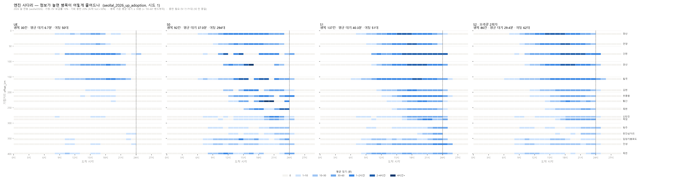
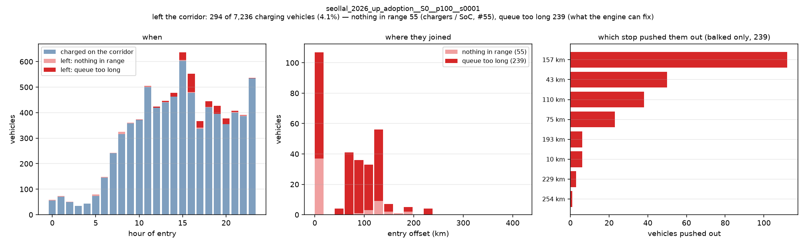
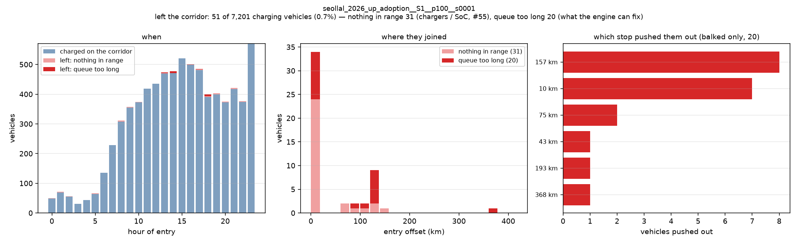

# 엔진 사다리 — 무엇이 좋아지고 무엇이 나빠지나 (#120 · #121)

> 한 줄: **사다리는 총 사회적 비용에서만 단조롭게 좋아진다.** S0 → S1 → S2 가
> **바닥–천장 격차 축소율** 0% → 4.5% → **21.0%** (시드 14개, 이탈 맞춤).
> 완전 예측 벤치마크는 27.5% — **예측 오차 손실 6.5 ± 3.7 %p** (#121).
>
> 그런데 **S1 은 병목 칸이 14개 시드 전부에서 S0 보다 많다** (93.5 → 133.1).
> 나빠진 게 아니라 **S0 가 내보낸 차 183대를 S1 이 붙잡고 있는 값**이다.



**이탈은 반드시 같이 본다** — 위 그림만 보면 S0 가 제일 좋아 보인다.

| S0 (이탈 294대) | S1 (이탈 51대) |
|---|---|
|  |  |

재현:

```bash
python scripts/plot_ladder.py --seed 1                 # ① 사다리 히트맵
python scripts/gap_table.py  --seeds 1-20              # ② 격차 축소율 표
python scripts/plot_escaped.py <run_id>                # 이탈 — ①과 반드시 같이 본다
```

> 그림은 **시드 1** 이다. 병목 칸·평균 대기는 14개 시드 평균과 비슷하지만,
> **총 사회적 비용은 시드 1 이 S1 에게 유난히 나쁘다** (§1). 숫자를 말할 때는
> 그림의 시드가 아니라 §2 의 표를 쓸 것.

---

## 1. ⚠ 시드 하나로 보면 틀린다

처음에 **시드 1 하나**로 보고 *"S1 이 S0 보다 나쁘다"* 고 판단했다. 14개 시드로
보니 **총 사회적 비용에서는 S1 이 낫다.** 기록으로 남긴다.

| | 시드 1 | **14개 시드 평균** |
|---|---|---|
| S0 vs S1 총비용 | S1 이 **나쁨** (7,313 vs 7,283) | S1 이 **나음** (7,291 vs 7,516) |
| 손익분기 이탈 비용 | 127분 (가정값 120 **바로 옆**) | **46분** (가정값 120 과 멀다) |

시드 1 은 **S1 에게 유난히 나쁜 시드**였다. 14개 중 **9개**에서 S1 이 S0 보다 낫다.

> **규칙: 사다리 비교는 시드 하나로 말하지 않는다.** 단계 간 차이가 시드 간 분산과
> 같은 크기다.

---

## 2. 바닥–천장 격차 축소율 (바닥 S0 = 0%, 천장 UE = 100%)

> **지표 이름:** **바닥–천장 격차 축소율** (표에서는 `격차 축소율`, 영문 `gap closed (%)`).
> **바닥에서 천장까지의 거리 중 몇 %를 좁혔나.**
>
>     격차 축소율 = (S0 − 이 칸) / (S0 − UE) × 100
>
> **상한도 하한도 없다.**
>
> - **음수는 실제로 나온다** — S1 의 평균 대기 격차 축소율이 **−2.7%** 다 (바닥보다 나쁘다).
> - **100% 초과도 수식상 막혀 있지 않다.** UE 는 Wardrop 균형(**이기적** 균형)이고
>   SO(사후 최적해)는 별개의 기준선이다 (`UE_equilibrium.md`). 다만 **우리는 UE 를
>   넘는 것을 목표로 삼지 않는다** — DESIGN §1 이 "넘어야 할 대상이 아니라 메울 대상"
>   으로 못 박았다. 지표가 그 경우에도 안 깨지게 두는 것뿐이다.
>
> 그래서 "달성률·도달률·진행률" 로 부르지 않는다 (0~100 으로 들린다).
> **"최적" 이 들어간 이름도 쓰지 않는다** — UE 는 최적이 아니라 이기적 균형이다.

> **정정됨 (#121 · #123, 2026-10-13).** 이 절의 이전 표에서 "S2" 라고 적힌 행은
> 사실 **오라클(`PERFECT_ROLLING`)** 이었고, 시드 집합도 바닥·천장(14개)과 달랐다
> (6개). 지금 표는 **공통 시드 14개**, **이탈을 맞춘** 값이다.

**공통 시드 14개**, 이탈은 S1 대비 **+8% · +11%** 로 맞췄다
(`scripts/gap_table.py` 가 벗어나면 격차 축소율을 안 찍는다 — `docs/compare_rule.md`).

> ⚠⚠ **S3 행은 다시 재야 한다 (#143, 2026-11-07).** 그룹 채점기가 **윈도우 안
> 상호작용을 한 번도 세지 않았다** — 즉 이 표의 S3 는 *결합을 하지 않은 S3* 다.
> S0·S1·S2·UE·완전예측 행은 그룹 채점기를 쓰지 않으므로 **그대로 유효하다.**
> 아래 「채점기를 고쳤다」 블록에 무엇이 어떻게 틀렸는지 적었다.

### 평균 대기 (분)

| 칸 | 값 | ±95% | 격차 축소율 | 이탈 |
|---|---:|---:|---:|---:|
| UE (천장) | 6.3 | 0.7 | 100% | 42.3 |
| S0 (바닥) | 38.5 | 2.0 | 0% | 238.9 |
| S1 | 39.3 | 1.9 | **−2.7%** | 55.5 |
| **S2 (관측 예측)** | 33.1 | 2.2 | **16.7%** | 60.1 |
| S3 | 32.7 | 2.2 | **18.1%** | 58.5 |
| S4 | — | — | — | — |
| *완전예측 (벤치마크)* | *30.7* | *1.2* | *24.1%* | *61.4* |

### 총 사회적 비용 (h) = 총 체류 + 이탈 × 120분

| 칸 | 값 | ±95% | 격차 축소율 | 이탈 |
|---|---:|---:|---:|---:|
| UE (천장) | 2,557.6 | 98.3 | 100% | 42.3 |
| S0 (바닥) | 7,516.1 | 285.7 | 0% | 238.9 |
| S1 | 7,290.8 | 281.7 | **+4.5%** | 55.5 |
| **S2 (관측 예측)** | 6,474.2 | 313.6 | **+21.0%** | 60.1 |
| S3 | 6,417.5 | 313.0 | **+22.2%** | 58.5 |
| S4 | — | — | — | — |
| *완전예측 (벤치마크)* | *6,151.8* | *183.5* | *27.5%* | *61.4* |

**S3·S4 행의 빈칸이 남은 작업 목록이다.**

> ### ⚠ S4 골격 — **다시 물으니 오히려 나빠졌다** (2026-11-05, #142 · 시드 1)
>
> 시간축을 열었다. 시뮬레이터가 **가고 있는 차도 매 Δt 다시 묻고**, 정책이 다른
> 휴게소를 답하면 경로가 바뀐다 (`reask_en_route`).
>
> | | S2 | S3 | **S4** |
> |---|---:|---:|---:|
> | 총 체류 (시드 1) | 6,284.9h | 6,288.3h | **6,510.5h** |
> | 평균 대기 | 33.25분 | 33.24분 | **35.21분** |
> | 병목 칸 | 118 | 109 | **98** |
> | 이탈 | 57 | 57 | 55 |
> | 계산시간 | 24.8초 | 76.8초 | **768.6초** |
> | 재배정 | — | — | **15,960회** (거부 2,593) |
>
> **재배정이 충전 차량 한 대당 2.2회다.** 최적화가 아니라 **요동**이다. 매 Δt
> 그룹 구성이 바뀌니 "지금 최선" 이 계속 흔들리고, 차가 따라다니다가 체류가
> 늘었다. #113 의 점질량 진동, #139 티켓이 경계한 *"반복 최적반응은 수렴 안 할
> 수 있다"* 와 같은 종류다.
>
> **병목 칸만 줄었다** (109 → 98). 차를 흩어 놓기는 했는데 그 대가로 각자가 더
> 오래 머물렀다.
>
> #### 이게 #144 가 필요한 이유다
>
> 롤링 호라이즌에서 **약속을 지키게 만드는 장치**가 아직 없다 —
> terminal penalty 도, 재배정 비용도, solver 도 없다. 지금은 **제약 없는
> 재계획**이고, 제약 없는 재계획이 요동치는 것은 예상된 결과다.
>
> 지금 있는 유일한 제약은 `relocate_lead_min`(기본 10분)뿐이고, 그것이 2,593회를
> 막았다. **이 값을 키우는 것이 가장 싼 1차 실험**이다.
>
> ⚠ **시드 1 하나다. 판정이 아니다.** 14시드로 말한다 (#121 · #139 에서 두 번
> 배웠다). 그리고 S4 는 한 시드에 **12.8분**이 걸려 14시드면 3시간이다 — 계산량
> 자체가 #77 의 보고 대상이다.

> ### ⚠ 리드타임 스윕 — **손해는 재배정이 아니었다** (2026-11-06, #142 · 시드 1)
>
> 위 블록이 *"`relocate_lead_min` 을 키우는 것이 가장 싼 1차 실험"* 이라고 적었다.
> 돌렸다. **키우면 나빠진다.**
>
> | 리드 | 총 사회적 비용 | S3 대비 | 이탈 | 평균 대기 | 병목 칸 | 재배정 | 거부 |
> |---|---:|---:|---:|---:|---:|---:|---:|
> | **S3** | 6,402.3h | — | 57 | 33.24 | 109 | — | — |
> | 10분 | 6,620.5h | **+218.3h** | 55 | 35.21 | **98** | 15,960 | 2,593 |
> | 20분 | 6,904.1h | +501.9h | 62 | 37.39 | **93** | 12,467 | 6,220 |
> | 30분 | 7,036.8h | +634.5h | 66 | 38.59 | 99 | 9,422 | 9,105 |
> | 60분 | 7,216.7h | +814.4h | 70 | 40.02 | 96 | 4,552 | 17,015 |
> | **100,000분** | 6,833.6h | +431.4h | 84 | 36.61 | 108 | **0** | 27,160 |
>
> (상행 adoption · 윈도우 4 · 관측 strength 0.30 · 이탈 비용 120분.
> `runs/sweeps/s4_lead_strength0.3.csv`)
>
> **리드를 키우면 재배정이 3.5배 줄고 결과는 단조롭게 나빠진다.** 미리 적어 둔 세
> 갈림길 — 좋아진다 / S3 로 수렴한다 / 중간 최적점 — **어느 것도 아니다.** 가장
> 좋은 S4 는 **제약이 가장 약한** 점이다.
>
> #### ★ ∞ 를 재니 전제가 깨졌다
>
> *"무한히 키우면 모든 재배정이 거부되니 S3 와 같아진다"* 고 전제했다. 아니다 —
> 리드 100,000분에서 **재배정 0회인데 S3 보다 +431.4h 나쁘고 이탈이 +27 이다.**
>
> **한 대도 안 옮겼는데 431h 를 잃는다.** 그러니 손해는 재배정이 아니다.
> `reask_en_route` 로 **가고 있는 차를 윈도우에 넣는 것 자체**가 처음 묻는 차들의
> 배정을 망친다. S3 의 이동·교환은 그룹 **합**으로 계획을 받아들이고 `_rebook` 으로
> 원장에 커밋하는데, 그 계획이 전제한 "가던 차들의 이동" 을 사후에 전부 되돌리면
> 남은 차들은 **오지 않은 그룹에 맞춰 고른 자리**에 남는다.
>
> | | 크기 | 리드타임과의 관계 |
> |---|---:|---|
> | ① **윈도우 오염** — 가던 차가 후보로 들어온다 | +431h | **리드와 무관** (∞ 에서도 남는다) |
> | ② **사후 거부의 비일관** — 그룹 최적에서 한 대만 되돌린다 | 최대 +383h | 재배정 ≈ 거부 일 때 최악 (리드 60분) |
>
> 재배정은 **①을 일부 되돌린다** — 리드 10분의 15,960회가 병목을 109 → 98 로,
> 이탈을 57 → 55 로 되돌려 +431h 를 +218h 로 줄인다. **옮기는 일은 값이 있다.**
> 그것을 사후에 되돌리는 방식이 값을 깎는다.
>
> #### 이게 바꾸는 것
>
> **#142 의 판정(5%p)은 이 구현으로 돌리면 안 된다.** 14시드 3시간을 들여 재는
> 것이 시간축의 값이 아니라 **교란 두 개의 합**이다. #118(흐린 오라클) ·
> #139(교환 0회) 와 같은 모양이다 — 재기 전에 재는 대상이 맞는지 본다.
>
> **#144 의 방향은 맞지만 진단이 다르다.** 더 막는 것이 아니라 **목적함수 안에서**
> 재배정 비용을 `_group_total` 이 수락 전에 평가해야 한다. 지금은 계획을 커밋한
> 뒤에 덮어쓴다. 그리고 `relocate_lead_min` 의 사후 거부는 **운영 제약을 표현하는
> 방법으로 틀렸다** — 비용이어야 하고 거부여서는 안 된다.
>
> ⚠ **시드 1 하나다. 판정이 아니다.** 다만 방향은 네 점 + ∞ 에서 한결같고, ∞ 의
> 재배정 0회는 **시드와 무관한 구조적 사실**이다.

> ### ★ 전수 열거 — **정확히 풀면 더 나빠진다** (2026-11-06, #143 · 시드 1)
>
> S3 의 윈도우는 **4대**이고, 이동 연산자의 후보가 *그룹이 이미 쓰는 휴게소*로
> 제한된다. 그래서 그룹 하나의 조합이 **4⁴ = 256 이하**다. 그리고 채점기
> (`_group_total`)는 근사가 아니라 정확한 Σd 를 순차 투영으로 계산한다.
>
> **즉 참 최적해를 근사 없이 구할 수 있다.** 구해서 휴리스틱과 비교했다
> (`S3_EXACT` · 그룹 1,990개 · 조합 169,278회).
>
> #### ① 휴리스틱은 그룹 안에서 거의 안 진다
>
> | | |
> |---|---:|
> | 열거가 이긴 그룹 | **22 / 1,990 = 1.1%** |
> | 하루 통째로 되찾은 체류 | **79.1분 = 1.3h** |
> | 계산시간 | 110.5s → **419.0s (3.8배)** |
>
> **3.8배를 더 써서 0.02% 를 되찾는다.** 이동·교환은 이미 거의 최적이다.
>
> #### ② 그런데 전역으로는 **209h 나빠진다**
>
> | | S3 | S3_EXACT | |
> |---|---:|---:|---|
> | 총 체류 | 6,288.3h | 6,509.7h | +221.4h |
> | 이탈 | 57 | 51 | −6 |
> | **총 사회적 비용** | **6,402.3h** | **6,611.7h** | **+209.4h** |
> | 병목 칸 | 109 | **120** | +11 |
>
> (이탈 차이 6 이 허용(5)을 넘어 **격차 축소율은 보고하지 않는다** —
> `docs/compare_rule.md`. 총 사회적 비용은 이탈을 120분으로 품은 값이다.)
>
> **국소 이득 1.3h ↔ 전역 손해 209.4h. 159배다.**
>
> #### ③ 왜 — DESIGN §6.2 의 주장이 윈도우 크기에 **비례해서만** 성립한다
>
> §6.2 는 *"윈도우 안 모든 차량의 체류시간 합을 한 번에 최소화하므로 외부효과가
> 목적함수에 **자연히 포함됩니다**"* 라고 적었다.
>
> **윈도우 안 차들에 대해서만 참이다.** 그룹 4대의 Σd 를 최소화하면 그 선택이
> **그룹 밖 수천 대**에게 미는 비용은 목적함수에 없다. `|W| = 4` 는 전체의 0.1%
> 도 안 되므로 **외부효과의 거의 전부가 윈도우 밖**이다.
>
> 그래서 정확히 풀수록 국소 이득을 더 공격적으로 긁어내고 그만큼 더 떠넘긴다.
> **병목 칸이 109 → 120 으로 늘어난 것**이 그 흔적이다 — 쏠림이 심해졌다.
>
> #### ④ #142 와 같은 모양이다
>
> | | 무엇을 더 줬나 | 결과 |
> |---|---|---|
> | #142 리드타임 스윕 | 제약을 더 걸었다 | 단조롭게 나빠졌다 |
> | #143 전수 열거 | 최적화 능력을 더 줬다 | 209h 나빠졌다 |
>
> **둘 다 solver 가 아니라 목적함수를 가리킨다.** 지금 목적함수에 힘을 더 주면
> 나빠진다. 남은 일은 *"더 잘 푸는 것"* 이 아니라 **"무엇을 푸는지를 고치는 것"**
> 이다 — $W$ 를 키우거나(#143), 윈도우 밖 비용에 값을 매기거나(시간축은 #144 의
> terminal penalty, 공간축은 #138 의 MEC).
>
> #### ⑤ 그러면 §6.2 의 서열이 뒤집힐 수 있다
>
> §6.2 는 MEC 를 *"공동 최적화를 한 대씩 근사한 형태"*, 즉 **더 약한 것**으로 뒀다.
> 그런데 MEC 는 **윈도우 밖 차들에게 가는 비용을 명시적으로 센다.** `|W| = 4` 의
> 공동 최적화는 그걸 아예 안 센다.
>
> > **가설:** 작은 윈도우에서는 MEC 가 공동 최적화보다 **나을 수 있다.** 근사가
> > 덜 정확해서가 아니라 **더 많은 것을 세기 때문이다.**
>
> 판정이 아니다 — 시드 1 이고 MEC 는 아직 구현 전이다. 다만 #138 은 이제 사다리의
> 한 칸이 아니라 **이 측정이 던진 질문의 답 후보**다. #140 이 갈린다.
>
> ⚠ **시드 1 하나다. 판정이 아니다.** 다만 ①의 "휴리스틱이 거의 최적" 은 조합 수
> 상한에서 나오는 **구조적 사실**이다.

> ### ★ 윈도우 스윕 — **윈도우는 손잡이가 아니다** (2026-11-06, #143 · 시드 14개)
>
> 위 블록이 *"손해는 목적함수가 윈도우 밖을 안 세기 때문"* 이라고 했다. 윈도우를
> 키우는 것은 그 원인을 직접 건드린다. 재 봤다.
>
> #### ① 시드 1 은 윈도우 2 에 내부 최적점을 보였다 — **그리고 잡음이었다**
>
> | 윈도우 | 총 사회적 비용 | S2 대비 | 이탈 | 계산시간 |
> |---|---:|---:|---:|---:|
> | S2 (결합 없음) | 6,398.9h | — | 57 | ~25s |
> | **2** | **6,328.0h** | **−70.9h** | 60 | 62s |
> | 4 ← 기본값 | 6,402.3h | +3.4h | 57 | 113s |
> | 6 | 6,490.4h | +91.5h | 52 | 220s |
> | 8 | 6,456.3h | +57.4h | 51 | 421s |
> | 12 | 6,439.0h | +40.1h | 51 | 985s |
>
> 큰 윈도우는 **이탈을 구해 내고 체류로 값을 치른다** (이탈 60 → 51). 구해 낸 한
> 대가 남들의 체류로 **860~1,606분**을 쓰는 거래인데, 등록된 이탈 비용은 **120분**
> 이다 — §4 의 *"이탈 비용 가정이 순위를 바꾼다"* 가 여기서 그대로 걸린다.
>
> #### ② 14시드 대응 비교 — 시드 1 의 읽기가 **틀렸다**
>
> | 비교 | 평균 차 | 95% CI | 이득 시드 | 판정 |
> |---|---:|---|---:|---|
> | 윈도우 2 − 윈도우 1(=S2) | −38.8h | [−114.0, +36.4] | 9/14 | **0 과 구분 안 됨** |
> | 윈도우 4 − 윈도우 1(=S2) | −87.8h | [−181.8, +6.2] | 10/14 | **0 과 구분 안 됨** |
> | 윈도우 4 − 윈도우 2 | −49.0h | [−122.5, +24.5] | 10/14 | **0 과 구분 안 됨** |
>
> 이탈 차 평균 +0.00 / −1.64 / −1.64 로 **전부 허용(5) 안** — 비교가 성립한다.
>
> **부호가 뒤집혔다.** 윈도우 4 − 윈도우 2 가 시드 1 에서는 **+74.3h**(2 가 좋다),
> 14시드 평균으로는 **−49.0h**(4 가 좋다)다.
>
> > 시드 하나로 속은 것이 **이 프로젝트에서 세 번째**다 — #121(S2 시드 6개) ·
> > #139(S3 시드 5개) · 그리고 이것.
>
> #### ③ 그래서 §2 의 S3 판정이 **다시 확인됐다**
>
> #143 을 시작할 때 *"#139 는 window = 4 에서 닫았으니 윈도우에 묶인 판정일 수
> 있다"* 고 적었다. **아니었다.** 윈도우 1 → 2 → 4 로 키우면 평균은 내려가지만
> 구간이 전부 0 을 품고, 큰 윈도우는 오히려 진다.
>
> **윈도우는 손잡이가 아니다.** 중요한 외부효과는 **감당 가능한 어떤 윈도우보다도
> 밖**에 있다. 키우는 것이 아니라 **값을 매겨야** 한다 — 시간 방향은 terminal
> penalty(#144), 공간 방향은 MEC(#138).
>
> #### ④ 효과 크기가 측정 분해능 아래다 — 시드를 더 써도 판정은 안 바뀐다
>
> CI 반폭이 ±70~95h, 총량이 6,300h 이므로 **±1.1~1.5%** 다. 쫓던 효과(40~90h)와
> 같은 크기다. 가르려면 윈도우 4−2 는 약 30시드, 윈도우 4−S2 는 약 18시드다.
>
> > ⚠ **유의해지는 것과 판정 기준을 넘는 것은 다르다.** #139 의 미리 정한 기준은
> > *"S0→UE 격차를 5%p 이상 더 메운다"* 였다. 0 과 갈라져도 88h 는 그 기준에 한참
> > 못 미친다. **시드를 더 쓰는 것이 판정을 바꾸지 않는다.**
>
> #### ⑤ 그래서 solver 가 할 일이 없다
>
> | solver 를 붙이는 이유 | 결과 |
> |---|---|
> | 같은 윈도우를 **더 잘 푼다** | 전수 열거: 그룹 1.1% · 하루 1.3h. **전역 209h 악화** |
> | **윈도우를 키운다** | 0 과 구분 안 됨. 큰 윈도우는 졌다 |
>
> 둘 다 닫혔다. #143 은 **MILP 를 붙이지 않는다** — 붙일 이유가 없다는 것이
> 산출물이다. (`docs/objective.md` §3.6 · §3.7)

> ### ★ S3 판정 — **공간축은 과녁이 아니다** (2026-10-25, #139 · 시드 14개)
>
> ```
> S3 − S2 = +1.20 ± 2.01 %p      (대응 비교, n=14, 윈도우 4, 이탈 맞춤)
>   구간 상단 +3.21%p  <  미리 정한 기준 5%p   →  **기준 미달이 확실하다**
>   구간 하단 −0.82%p  <  0                    →  0 과도 구분되지 않는다
> ```
>
> **#139 가 결과를 보기 전에 정한 그대로 기록한다** — *"S2 대비 5%p 이상 더 메우지
> 못하면 공간축은 과녁이 아니라고 적고, 남은 몫을 시간축(롤링)과 용량으로 돌린다."*
>
> 총 사회적 비용 차이는 **−56.7 ± 95.9 h** 로 0 을 포함한다. 이탈은 **−1.6 ± 1.4**
> 로 오히려 줄었다(맞춤 범위 안, S1 대비 +5%) — **개선이 이탈 통로에서 나온 것이
> 아니라는 뜻**이고, 그래서 "효과가 없다" 를 그대로 믿을 수 있다.
>
> #### ⚠ 5시드에서 했던 주장이 14시드에서 무너졌다 — 기록해 둔다
>
> | | n=5 (10-17) | **n=14 (10-25)** |
> |---|---|---|
> | S3 − S2 | +3.08 ± 4.48 %p | **+1.20 ± 2.01 %p** |
> | 병목 칸 | **5시드 전부 감소 · −13%** | **10/14 감소 · −5.1 ± 5.7 (0 포함)** |
>
> *"5개 시드 전부에서 같은 방향"* 이 **유의성의 근거가 못 된다.** 같은 일을 S1 에서도
> 겪었다 (시드 6개 +4.5 ± 4.9%p → 14개로 갈렸다). **방향의 일치는 표본이 작을 때
> 쉽게 생긴다.** §2 의 규칙을 다시 적는다 — **사다리 비교는 14 시드로 말한다.**
>
> #### 그래서 무엇이 달라지나
>
> ```
> 정보 축 (S1→S2)    +16.5%p   ← 크다
> 공간 결합 (S2→S3)  +1.2%p    ← 과녁이 아니다
> 남은 몫            ~78%p     → 시간축(S4·롤링) · 용량 · 점유 모형
> ```
>
> **같은 Δt 안의 차들끼리는 이미 거의 간섭하지 않는다.** 순차 결합(S1 의 예약원장)이
> 공간 조정의 몫을 이미 거의 다 가져갔다는 뜻이다. **S3 를 접는 것이 아니라**,
> S3 는 S4(롤링 MILP)의 **한 단면**으로 남고 과녁은 시간축으로 옮긴다.
>
> 계산 비용: S2 24.8초 · S3(윈도우 4) **76.8초 = 3.1배**. 윈도우 0 이면 S2 와 비트
> 단위로 같다 (`_candidate` 호출 120,448 회까지 동일).
>
> ⚠ 이 수치는 **설 연휴 `adoption` 레이어**의 것이다. 추석 실측 프로파일이 들어오면
> 다시 재야 한다 (#81).

---|---:|---|
> | S2 | 20.86 ± 8.82 %p | 14 시드 확정값 21.0% 과 일치 |
> | S3 | 23.93 ± 12.28 %p | |
> | **S3 − S2 (대응)** | **+3.08 ± 4.48 %p** | **신뢰구간이 0 과 5%p 를 **둘 다** 포함한다** |
>
> **그래서 "공간축이 과녁인가" 에 답할 수 없다.** 미리 정한 기준은 5%p 였는데,
> 점추정(+3.08)은 그 아래지만 구간 상단(+7.56)은 그 위다. §2 가 적어 둔 그대로다 —
> *"시드 6개로는 말할 수 없었다 (+4.5 ± 4.9 %p). 14개로 늘려서야 구분됐다."*
> **판정은 14 시드를 채운 뒤 #140 에서 한다.**
>
> #### 다만 **5 시드 전부에서 같은 방향인 지표가 하나 있다**
>
> | | S2 | S3 | |
> |---|---:|---:|---|
> | 병목 칸 | 108.8 | **94.6** | **−13% · 5 시드 전부 감소** (119→109·116→100·109→89·98→81·102→94) |
> | 이탈 | 53.4 | **51.8** | **−2.8%** (시드별 −5.5%~0%) |
>
> **이탈이 줄면서 비용이 줄었다는 점이 중요하다.** 이 프로젝트가 네 번 속은 통로는
> *"비관적으로 만들어 한계 차량을 내보내고 남은 줄이 짧아지는 것"* 이었다. S3 는
> 반대 방향이다 — **차를 더 붙잡으면서** 병목을 줄였다. 개선이 이탈 통로에서 나온
> 것이 아니라는 뜻이다.
>
> 계산 비용: S2 24.8초 · S3(윈도우 4) **76.8초 = 3.1배** (상행 adoption 시드1 하루).
> 윈도우 12 는 10분을 넘겨서 기본값을 4 로 뒀다. 윈도우 **0 이면 S2 와 비트 단위로
> 같다** — `_candidate` 호출 수까지 120,448 회로 같다.
>
> ⚠ **이 수치는 설 연휴 `adoption` 레이어의 것이다.** 추석 실측 프로파일이 들어오면
> 전부 다시 재야 한다 (#81). 그래서 #140(판정)을 그 뒤로 미뤘다.

> *완전예측* 은 사다리 칸이 아니라 **벤치마크**다 — 시뮬레이터의 실제 미래를 넣으므로
> 현실에서 구현할 수 없다 (DESIGN §8.2).

### 격차 분해 (DESIGN §8.2) — 이 칸이 채워졌다

| | |
|---|---:|
| 관측 예측의 격차 축소율 | **21.0%** |
| 완전 예측의 격차 축소율 | **27.5%** |
| **예측 오차 손실** | **6.5 ± 3.7 %p** |
| **남은 몫** | **72.5%p** — 정보로는 못 메운다. S3·S4 의 과녁 |

**대응 비교로 냈다** (같은 시드끼리, n=14). 수준의 신뢰구간은 서로 겹치므로
(S2 ±314h · 벤치 ±184h) 그걸로 "차이가 없다" 고 읽으면 틀린다 — 두 칸은 같은
시드를 돌았고, 시드 간 변동이 양쪽에서 상쇄된다.

> **시드 6개로는 말할 수 없었다** (+4.5 ± 4.9 %p, 잡음과 구분 안 됨). 14개로
> 늘려서야 구분됐다. `gap_table.py` 가 구분이 안 되면 **"하나의 숫자로 말하지 말 것"**
> 을 찍는다.

---

## ★★ 채점기를 고쳤다 — 그리고 사다리의 세 판정이 다시 열렸다 (#143)

MILP 를 붙이다가 찾았다. 쌍별 계수를 `_group_total` 과 맞춰 보니 **그룹당 569분**이
어긋났다. 근사로 설명되는 크기가 아니었다.

`S3Policy._group_total` 은 그룹 전원을 원장에 순서대로 넣으며 비용을 잰다. 그
순서가 **`offset_km` 오름차순**이었다. 그런데 코리도에서는 **모든 차가 같은
속도**라서, 어느 휴게소에서든

    offset 이 크다  →  휴게소가 가깝다  →  **먼저 도착한다**

즉 그룹 순서는 **도착 순서의 정확한 역순**이다. FIFO 는 *"내 뒤에 오는 차"* 를
버리므로

| 재는 차 | 그때 원장에 있던 것 | 세어졌나 |
|---|---|---|
| group[0] (가장 멀다 = 가장 늦게 온다) | 비어 있다 | — |
| group[1] | group[0] — **내 뒤에 온다** | **버려진다** |
| group[2] | group[0], group[1] — 둘 다 내 뒤 | **버려진다** |

**윈도우 안의 어떤 차도 다른 차를 보지 못했다.** 50kW 한 대인 휴게소에 두 대를
같이 보내면

    그룹 순서로 쌓기 (그때)   75.6분   = 39.6 + 36.0   ← 둘이 서로를 못 본다
    도착 시각 순으로 (지금)   81.6분   = 36.0 + 45.6   ← 뒤차가 6.0분 기다린다

**그 6분이 공동 최적화가 재려던 바로 그 외부효과다.**

### 이동·교환은 그럼 무엇을 보고 수를 뒀나

**윈도우 밖 혼잡만** 봤다. 한 대를 옮기면 그 차의 비용은 (원장에 이미 있는 밖의
예약들 때문에) 달라지므로 합이 움직인다. 그래서 이동 성공이 0 이 아니었다 (시드 1
하루 487회). 하지만 *"내가 옮기면 **같은 윈도우의** 저 차가 더 기다린다"* 는 한
번도 계산에 들어가지 않았다.

### 왜 테스트가 안 잡았나

`tests/test_s3.py` 의 두 축이 **둘 다 이 경로를 비껴간다.**

| 테스트 | 왜 통과했나 |
|---|---|
| 윈도우 0 으로 돈 S3 == S2 (비트 단위) | 개선 패스를 **아예 안 도는** 경로다 |
| 교환이 실제로 일어난다 | **다른 휴게소로** 옮기는 경우다 |

같은 휴게소에 쌓인 두 대의 **합**을 숫자 하나로 확인하는 테스트가 없었다. 지금은
있다 (`test_the_group_scorer_counts_the_queue_inside_the_window`).

> 교훈은 *"테스트를 더 쓰자"* 가 아니다. 동일성 테스트와 효과 테스트를 **둘 다
> 갖고도 그 사이의 구멍**으로 빠졌다. **이 칸이 재려는 것을 직접 재는 테스트**가
> 없었던 것이다.

### 무엇이 다시 열리나

| 그때 적은 결론 | 지금 |
|---|---|
| #139 — 공간축은 과녁이 아니다 (S3 − S2 = +1.20 ± 2.01 %p) | **다시 재야 한다** |
| #143 — 정확히 풀면 전역 209h 나빠진다 | **뒤집혔다 — 92.1h 이긴다** (아래) |
| #143 — 윈도우는 손잡이가 아니다 (14시드) | 키워서 얻을 것이 안 세어지고 있었다 |

### ★★ 고친 채점기로 다시 쟀다 — **전수 열거가 이긴다**

상행 adoption 시드 1 · 윈도우 4 · 샌드박스.

| | 총 사회적 비용 | 체류 | 이탈 | 병목 | 계산시간 |
|---|---:|---:|---:|---:|---:|
| `local` (이동·교환) | 6,418.8h | 6,302.8h | 58 | 106 | 98s |
| **`exact` (전수 열거)** | **6,326.7h** | 6,214.7h | **56** | **105** | 507s (5.2배) |
| `milp` (쌍별 근사) | 6,425.3h | 6,321.3h | 52 | 107 | 138s (1.4배) |

**92.1h 이긴다** (−1.4%). 어제는 **209h 졌다.** 그리고 **이탈 차가 −2 로 허용(5)
안**이라 비교가 성립한다 — 어제 측정과 달라진 점이다.

이유는 어제의 진단이 **채점기 고장의 결과**였다는 것이다. 그때 *"윈도우 안의
Σd 를 최소화하면 윈도우 밖에 미는 비용이 목적함수에 없다"* 고 적었는데,
**윈도우 안 비용조차 없었다.** 그 상태에서 "정확히 푼다" 는 것은 *잘못된
목적함수를 정확히 푸는 것*이었다. 목적함수가 제 것을 세게 되자 **정확히 푸는
것이 이긴다.**

MILP 는 전수 열거에 **98.6h 진다** — 근사 오차는 그룹당 0.341분(체류의 0.2%)
뿐인데도. **거의 같은 배정이 많아서**(#123) 0.3분 차이로도 다른 쪽을 고른다.
그래서 근사 해는 언제나 정확한 채점기로 다시 재서 휴리스틱과 견준다.

⚠ **시드 하나다. 판정이 아니다** — 이 프로젝트에서 시드 하나로 세 번 속았다.

시드 1 에서 고친 뒤 S3 는 6,402.3h → **6,418.8h** 다 (+16.5h, 이탈 57 → 58).
크지 않다. **그런데 그건 "결합이 쓸모없다" 는 뜻이 아니다** — 지금까지의 S3 가
*결합을 하지 않은 S3* 였으니, 이제부터가 결합의 값을 재는 자리다.

옛 run 은 `params_json` 의 `group_scorer` 가 없어서 `stale_reason` 이 막는다.
**이 프로젝트에서 같은 함정을 여섯 번째로 밟지 않으려고** 적어 둔 것이다
(#55 · #101 · #118 · #119 · #139 · #142).

---

## 3. S1 은 "빠르게" 가 아니라 "붙잡아서" 이긴다

지표마다 방향이 다르다. 14개 시드 평균:

| 지표 | S0 | S1 | |
|---|---:|---:|---|
| 이탈 | 238.9대 | **55.5대** | S1 압승 (**−77%**) |
| 병목 슬롯 | 93.5 | **133.1** | S1 패 — **14개 시드 전부에서** |
| 평균 대기 | 38.5분 | 39.3분 | S1 약간 패 |
| 총 사회적 비용 | 7,516h | **7,291h** | S1 승 (9/14 시드) |

**메커니즘은 하나다.** S0 는 못 기다리는 차 **239대를 고속도로 밖으로 내보낸다.**
나간 차는 충전기를 안 쓰므로 남은 사람의 줄이 짧아지고 히트맵이 밝아진다. S1 은
그 차들을 **붙잡는다.** 붙잡힌 차가 줄을 만들어 병목 칸이 늘고 평균 대기가
조금 오르지만, **2시간짜리 이탈을 면한다.**

이탈 이유를 가르면 더 분명하다 (시드 1):

| | S0 | S1 |
|---|---:|---:|
| 이탈 전체 | 294대 | 51대 |
| **balked** (줄이 길어서 — **엔진 책임**) | **239대** | **20대** |
| no_plan (닿는 곳이 없어서 — 충전기 공백) | 55대 | 31대 |

**엔진이 고칠 수 있는 이탈을 239 → 20 (−92%) 로 줄였다.** 이게 히트맵에는 전혀
안 보인다 — 오히려 S1 을 더 어둡게 만든다.

> **그래서 히트맵 혼자서는 거짓말을 한다.** 이탈 패널 없이 내놓으면 *"S0 가 제일
> 좋다"* 로 읽힌다.

---

## 4. 이탈 비용 가정이 순위를 바꾼다

총비용에 이탈을 세는데, **얼마로 세느냐**가 S0·S1 의 순위를 정한다.

    손익분기 이탈 비용 = 46.3분   (우리가 쓴 값 120분)

| 이탈 비용 | UE | S0 | S1 | S2 |
|---|---:|---:|---:|---:|
| 60분 | 2,515 | 7,277 | **7,235** | 5,897 |
| **120분 (가정)** | 2,558 | 7,516 | **7,291** | 5,947 |
| 180분 | 2,600 | 7,755 | **7,346** | 5,998 |

46분보다 크면 S1 이 이긴다. 우리 가정 120분은 **충분히 멀다** — 이 결론은 가정에
민감하지 않다. (시드 1 하나만 보면 손익분기가 127분이라 아슬아슬했다. §1 참고.)

---

## 5. ★ 숫자와 그림이 같은 것 — 병목 칸

    bottleneck_slots  =  히트맵에서 어두운 칸의 수
    (설계문서 §8.1: 휴게소 × 시간 평균 대기 ≥ 30분)

30분이 색 구간 경계(`WAIT_BINS_MIN`)와 **정확히 일치**한다 — "30–60 밴드부터" 가
곧 병목 슬롯이다. 심사에서 숫자를 의심받으면 **칸을 세라고 하면 된다.**

**기계가 그 약속을 검사한다.** `plot_ladder.py` 는 그리는 격자에서 다시 세어
`run_kpi` 와 대조하고, 다르면 **그림을 저장하지 않고 멈춘다.**

### 실제로 어긋났었다

처음에 가로축을 24시간으로 잘랐더니 **KPI 137 vs 그림 128** 이었다. 귀성 심야
도착이 자정을 넘어(최대 28시) 축에서 떨어진 것이다. `hours` 를 데이터 끝까지
늘려서 맞췄다 (익일 구간은 점선으로 가른다).

> 이걸 안 잡았으면, 발표에서 누군가 칸을 세는 순간 그림이 무너졌을 것이다.

---

## 6. UE 를 무엇으로 쓰는가 — **(A) 참고 천장으로 확정** (2026-10-11)

> **되돌릴 조건을 시험했고 충족되지 않았다 (2026-10-13, #64).** 실측 충전 로그
> 11,405건과 20개 UE 실행을 대조한 결과 휴게소×일 WAPE **78.49%**, 총 점유시간
> **−65.39%**, 충전 시작 피크 ±1시간 일치 **4/20** 이다.
> **UE = 참고 천장이 이제 추론이 아니라 실측 근거를 갖는다.**
>
> 그리고 UE 의 배분이 실측과 다른 **방향**도 드러났다 — UE 는 휴게소 안에서 가장
> 좋은 충전기 하나로 몰린다(`MAX_POWER_IDLE`). 혼합 운영사 휴게소 15곳 전부에서
> 한쪽이 세션을 거의 전부 가져가고, **분배 구간이 0곳**이다 (#128).
>
> ⇒ 우리가 100% 천장으로 쓰는 UE 는 **실측 대비 구조적으로 잘못 배분하는 해법**이다.
> 격차 축소율은 여전히 잘 정의되지만, 발표에서 이 말을 먼저 해야 한다.
> (`docs/sp3_64/review_20261013.md`)

UE 는 **하루 전체 계획을 열거하고 반복 균형을 돌린다.** 어떤 실시간 엔진보다
정보가 많다. 그래서 평균 대기 6.3분으로 S2 의 29.8분보다 **5배 좋다.**

두 입장이 양립하지 않는다.

**(A) 참고 천장으로 간다.** 근거는 DESIGN 자신의 조항이다.

설계문서 §1.2 는 UE 를 "재현 기준선" 으로 두면서 조건을 달았다 —
*"재현 검증(교통·충전) 없이 **'현실' 이라 부르지 않는다**"*. **그 조건이 아직
충족되지 않았다.**

| 재현 검증 | 상태 |
|---|---|
| 교통 (CTM) | 속도 MAPE 14.4% 통과 · **정체 재현율 0.00 미달** (#58) |
| 충전 (이용률) | **판정 보류** — 실측 로그 수집 중 (#112 · #64) |

그래서 문서를 뒤집은 것이 아니라 **문서 자신의 규칙을 적용했다.** 고친 곳:
DESIGN §1 관점(갱신 블록) · §1.2 용어표 · §1.3 RQ2 · §7.1 · §8.2 기준점 표.

**바닥은 S0 다** — 앱 화면만 보고 고르는 운전자가 지금 우리가 가진 가장 현실에
가까운 행동 모델이다. RQ2 도 "UE 대비" 에서 **"S0 대비(= S0→UE 격차의 몇 %)"** 로
바꿨다.

> **되돌릴 조건:** #64 의 실측 충전 로그가 들어와 재현 검증을 통과하면, UE 를 다시
> "재현된 현실" 로 부를 수 있는지 그때 판단한다.

---

## 7. "쏠림" 은 그대로 쓴다 — **자(尺)만 바꾼다**

처음에 *"쏠림 대신 병목이라고 하자"* 고 적었다. **그 권고를 거둔다.** 설계문서
§1.2 가 이유를 적어 뒀다 — *"'병목' 은 공급 부족으로 들림. 우리 주장은 **분배
문제**"*. 헤드라인 명사를 바꾸면 프로젝트의 핵심 주장이 약해진다.

**바꿔야 하는 것은 쏠림을 재는 자다.**

| | 지표 | S2 에서 |
|---|---|---|
| ❌ **균등도로 재지 않는다** | 최다 휴게소 몫 | 15.8% → **16.4%** — **나빠진다** |
| ✅ **시공간 병목 칸으로 잰다** | 휴게소×시간 평균 대기 ≥ 30분 | 133 → **86** |

균등도 차트를 띄우면 **우리 결론의 반례를 보여주는 셈**이다.

S2 의 이득은 고르게 퍼뜨려서가 아니라 **큐의 볼록성** 에서 온다 — 추풍령은 정차
600 → 550(−8%)인데 대기 51.0 → 17.8분(**−65%**). 진입부(양산 +3.4분, 언양 +6.1분)가
나빠지는 것은 감수한 거래다.

`docs/platform.md` 머리말에 같은 내용을 박았다.

---

## 8. 열린 것

| | |
|---|---|
| ~~**S2 시드 6개**~~ | **해결 (#121).** S2·완전예측을 14개로 올려 바닥·천장과 맞췄다 |
| ~~**p95 가 안 움직인다**~~ | **반증됐다 (#119, #123 에서 재확인).** 완전 예측은 못 움직이지만(112.6 → 113.1) **관측 예측은 움직인다** (→ 103.4). **이탈을 맞춘 뒤에도 남는다** — `docs/compare_rule.md` §1 |
| **진입부가 나빠진다** | 양산·언양. 재배치가 거기로 부하를 민다 |
| **UE (A)/(B)** | §6 — 팀이 확정할 것 |
| ~~**S4 판정이 막혀 있다**~~ | **막던 것을 없앴다 (#143).** 사후 거부를 **목적함수 안의 재배정 비용**으로 바꿨다 — 임박한 차는 계획에서 **고정**되고(결정변수에서 빼고 원장에는 남긴다), 그 밖은 $r_i$ 를 치른다. `hard_lock_min = inf` 가 **S3 를 비트 단위로 재현**하는 것이 검산이다. **그런데 아래 채점기 고장 때문에 아직 못 돌린다** |
| **목적함수가 윈도우 밖을 안 센다** | 전수 열거로 풀면 전역 209h 나빠졌다 — 다만 **그 측정은 아래 고장 위에서 났다.** §6.2 의 *"외부효과가 자연히 포함된다"* 가 **윈도우 안에서만** 참이라는 것 자체는 `\|W\|=4` 가 전체의 0.1% 도 안 된다는 데서 그대로 성립한다 |
| **윈도우를 키우면 메워지나 — 다시 열렸다** | 14시드로 *"0 과 구분 안 됨"* 을 얻어 닫았는데(#143), 그 측정이 **윈도우 안 상호작용을 안 세는 채점기**로 났다. 윈도우를 키워서 얻을 것이 바로 그것이다 — **재는 자가 눈을 감고 있었다.** 다시 재야 한다 |
| **측정 분해능** | 윈도우 비교의 CI 반폭이 ±1.1~1.5% 로 쫓는 효과와 같은 크기다. 가르려면 18~30시드. 다만 **유의해져도 5%p 기준은 못 넘는다** — 시드를 더 쓰는 것이 판정을 바꾸지 않는다 (#77 의 비용 보고 대상) |
| **MEC 의 위치가 바뀔 수 있다** | §6.2 는 MEC 를 공동 최적화의 *약한 근사*로 뒀는데, 작은 윈도우에서는 **더 많은 것을 세기 때문에 나을 수 있다.** #138 · #140 이 갈린다 |
| ★★ **채점기가 윈도우 안 상호작용을 안 셌다** | **#143 (2026-11-07).** `_group_total` 이 그룹을 `offset_km` 순으로 쌓았는데, 모두 같은 속도라 그 순서가 **도착 순서의 역순**이다 — FIFO 가 내 뒤 차를 버리므로 **윈도우 안의 어떤 차도 서로를 못 봤다.** 50kW 한 대에 두 대면 75.6분(그때) vs **81.6분**(진짜). 고쳤다(도착 시각 순). **#139 의 공간축 판정과 위의 두 줄이 전부 이 위에서 났다** — 다시 재야 한다 |
| **다시 재야 하는 것** | ① #139 의 S3 − S2 ② 전수 열거의 전역 209h ③ 윈도우 스윕 14시드. 셋 다 고친 채점기로. 옛 run 은 `params_json` 의 `group_scorer` 가 없어서 `stale_reason` 이 막는다 — **조용히 재사용되지 않는다** |
| ★★ **목적함수가 구조적으로 퇴화했다** | **#143.** 한 차의 비용이 **세 휴게소에서 소수점 9자리까지 같다** (6.482695101) — 줄이 없으면 체류 = 충전시간이고 충전시간은 **휴게소와 무관**하다. 그래서 같은 문제를 다르게 적기만 해도 하루 **115.8h** 갈렸다. 사전순 2단계 풀이로 **선택을 고정**했고 일치시켰다. 그런데 **깨는 것과 없게 하는 것은 다르다** |
| **MEC 의 근거가 하나 더 늘었다** | 위 퇴화를 없애는 항이 바로 한계 외부비용이다 — *"이 휴게소를 쓰면 나중에 올 차들의 여유가 얼마나 줄나"*. §6.2 는 MEC 를 공동 최적화의 **약한 근사**로 뒀지만, 이쪽에서 보면 **목적함수를 제대로 만드는 항**이다. #138 · #140 |
